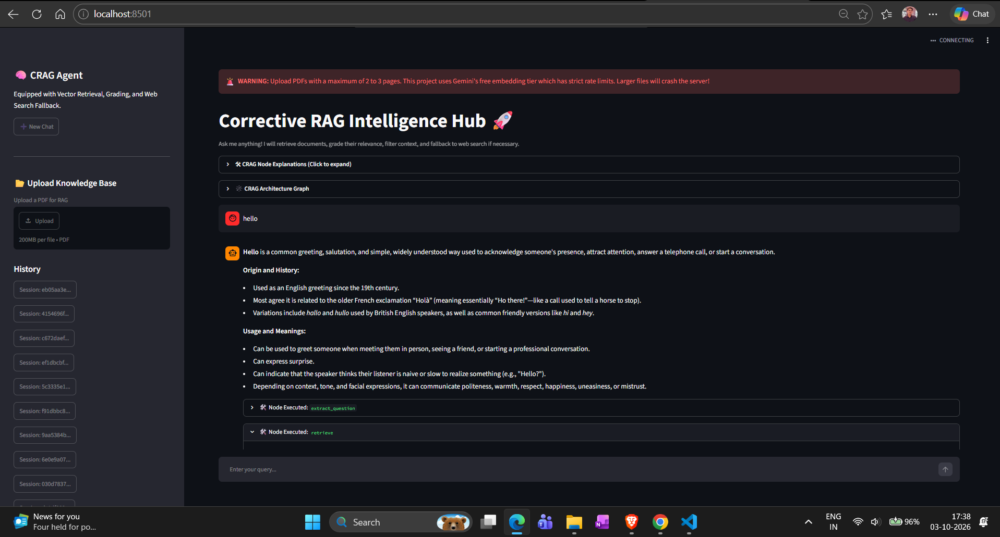
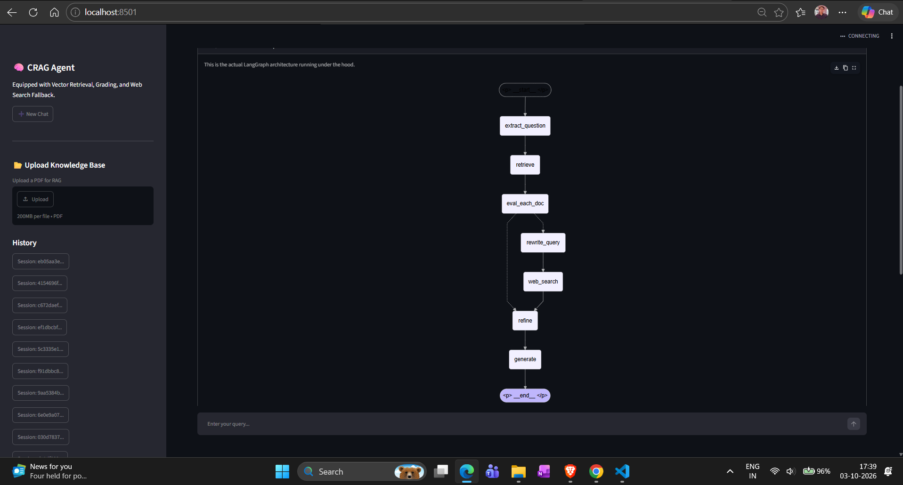

# 🚀 Corrective RAG (CRAG) Intelligence Hub

> **An intelligent, fault-tolerant, agentic RAG system that combines local PDF knowledge with real-time web search to deliver reliable and context-aware answers.**

Built using **LangGraph, LangChain, Google Gemini, FAISS, Tavily, HuggingFace, and Streamlit**, this project implements a **Corrective Retrieval-Augmented Generation (CRAG)** workflow that evaluates retrieved documents, filters irrelevant context, rewrites queries when necessary, and intelligently falls back to web search when local knowledge is insufficient.



---

## ✨ Key Features

### 🧠 Agentic CRAG Workflow

A stateful **LangGraph** workflow that mimics a researcher's reasoning process:

* 📄 Extract knowledge from local PDF documents
* 🔎 Retrieve relevant document chunks
* 🏆 Grade document relevance
* ✍️ Rewrite queries when retrieval quality is poor
* 🌐 Perform real-time Tavily web search
* 🧹 Refine and filter retrieved context
* 🤖 Generate grounded final responses

### 🛡️ Fault-Tolerant AI Engine

Designed with fallback mechanisms to improve application reliability:

* 🔑 **Dual Gemini API key fallback**
* 🔄 Automatic LLM fallback during API failures or rate limits
* 🧠 **Embedding fallback** from Gemini to local HuggingFace embeddings
* 🚫 Reduced dependency on external APIs
* ⚡ Better resilience during heavy workloads

### 🎯 Dynamic Context Filtering

Instead of blindly sending entire retrieved documents to the LLM:

* Retrieves relevant document content
* Scores and filters context
* Extracts useful sentences
* Reduces unnecessary token consumption
* Helps avoid oversized prompts and `429 Resource Exhausted` errors
* Improves answer relevance

### 🖥️ Interactive Streamlit UI

The application provides an intuitive interface with:

* 💬 Interactive question-answering
* 📊 Live execution logs
* 🔍 Retrieval and grading visibility
* 📦 Expandable workflow states
* 🧠 LangGraph architecture visualization
* 🌐 Transparent web-search fallback

### 🔐 DevSecOps Ready

The project structure is designed with future production deployment in mind:

**Docker → Trivy → SonarQube → Jenkins → Terraform → Ansible → AWS**

---

# 🧠 System Architecture

The application follows a corrective RAG pipeline implemented using **LangGraph**.



### 🔄 Workflow

```text
                    ┌─────────────────┐
                    │   User Query    │
                    └────────┬────────┘
                             │
                             ▼
                    ┌─────────────────┐
                    │ Extract / Parse  │
                    └────────┬────────┘
                             │
                             ▼
                    ┌─────────────────┐
                    │ Local Retrieval │
                    │     (FAISS)     │
                    └────────┬────────┘
                             │
                             ▼
                    ┌─────────────────┐
                    │ Grade Documents │
                    └────────┬────────┘
                             │
                  ┌──────────┴──────────┐
                  │                     │
            Relevant                 Irrelevant
                  │                     │
                  ▼                     ▼
          ┌──────────────┐      ┌──────────────┐
          │ Refine       │      │ Rewrite Query│
          │ Context      │      └──────┬───────┘
          └──────┬───────┘             │
                 │                     ▼
                 │             ┌──────────────┐
                 │             │ Tavily Web   │
                 │             │    Search    │
                 │             └──────┬───────┘
                 │                    │
                 └──────────┬─────────┘
                            │
                            ▼
                    ┌─────────────────┐
                    │ Generate Answer │
                    │   (Gemini LLM)  │
                    └────────┬────────┘
                             │
                             ▼
                    ┌─────────────────┐
                    │ Final Response  │
                    └─────────────────┘
```

---

# 🛠️ Tech Stack

| Category                    | Technology                       |
| --------------------------- | -------------------------------- |
| 🧠 LLM                      | Google Gemini                    |
| 🔗 LLM Framework            | LangChain                        |
| 🕸️ Agent Workflow          | LangGraph                         |
| 📚 Vector Database          | FAISS                            |
| 🔎 Web Search               | Tavily Search API                |
| 🤗 Local Embeddings         | HuggingFace / `all-MiniLM-L6-v2` |
| 🎨 Frontend                 | Streamlit                        |
| 🐍 Language                 | Python                           |
| 📄 Knowledge Source         | PDF Documents                    |
| 🐳 Containerization         | Docker                           |
| 🔍 Code Quality             | SonarQube                        |
| 🛡️ Security Scanning       | Trivy                             |
| 🔄 CI/CD                    | Jenkins                          |
| ☁️ Cloud                    | AWS                              |
| 🏗️ Infrastructure as Code  | Terraform                         |
| ⚙️ Configuration Management | Ansible                          |

---

# ⚡ Fault-Tolerant LLM Configuration

A primary-fallback architecture is used to improve availability and handle API failures or rate limits.

### 🔑 Dual API Key LLM Fallback

```python
# Primary LLM
primary_llm = ChatGoogleGenerativeAI(
    model="gemini-3.5-flash-lite",
    max_retries=1,
    google_api_key=API_KEY_1
)

# Fallback LLM
fallback_llm = ChatGoogleGenerativeAI(
    model="gemini-3.5-flash-lite",
    max_retries=2,
    google_api_key=API_KEY_2
)

# Automatic fallback
llm = primary_llm.with_fallbacks([fallback_llm])
```

### How it works

```text
              User Request
                   │
                   ▼
        ┌─────────────────────┐
        │ Primary Gemini API  │
        │      API_KEY_1      │
        └──────────┬──────────┘
                   │
             API Failure?
              /          \
            No            Yes
            │              │
            ▼              ▼
         Response    ┌─────────────────────┐
                     │ Fallback Gemini API │
                     │      API_KEY_2      │
                     └──────────┬──────────┘
                                │
                                ▼
                             Response
```

This approach reduces the possibility of the application failing completely because of a temporary API limit or failure.

---

# 🧩 Fault-Tolerant Embedding System

The application also implements an embedding fallback strategy.

### Primary

**Google Gemini Embeddings**

### Fallback

**HuggingFace `all-MiniLM-L6-v2`**

```python
# Primary embeddings
primary_embeddings = GoogleGenerativeAIEmbeddings(
    model="models/gemini-embedding-2"
)

# Local fallback embeddings
fallback_embeddings = HuggingFaceEmbeddings(
    model_name="all-MiniLM-L6-v2"
)

# Automatic fallback
embeddings = primary_embeddings.with_fallbacks(
    [fallback_embeddings]
)
```

### Embedding Architecture

```text
              Document / Query
                     │
                     ▼
          ┌─────────────────────┐
          │ Gemini Embeddings   │
          │      Primary        │
          └──────────┬──────────┘
                     │
              API unavailable?
                /           \
              No             Yes
              │               │
              ▼               ▼
          Embedding     ┌─────────────────┐
                         │ HuggingFace    │
                         │ MiniLM-L6-v2   │
                         └────────┬────────┘
                                  │
                                  ▼
                              Embedding
```

The local embedding model helps keep the application functional even when the external embedding API becomes unavailable.

---

# 📚 RAG Pipeline

The system follows a corrective retrieval process rather than directly generating an answer from the first retrieved documents.

### 1️⃣ Document Processing

PDF documents are loaded and processed into smaller chunks.

```text
PDF
 ↓
Document Loader
 ↓
Text Extraction
 ↓
Chunking
 ↓
Embeddings
 ↓
FAISS Vector Store
```

### 2️⃣ Retrieval

When the user asks a question, the system searches the FAISS vector database for relevant document chunks.

### 3️⃣ Document Grading

Retrieved documents are evaluated for relevance.

If the retrieved information is sufficiently relevant, the workflow continues with local knowledge.

If the information is insufficient, the query is rewritten.

### 4️⃣ Query Rewriting

The original query is transformed into a better search query to improve retrieval quality.

### 5️⃣ Web Search

If local knowledge is insufficient, **Tavily Search** is used to retrieve additional real-time information from the web.

### 6️⃣ Context Refinement

Relevant information is filtered before being passed to the LLM.

### 7️⃣ Answer Generation

The final context is provided to Gemini to generate a grounded response.

---

# 🎯 Dynamic Context Filtering

One of the important optimizations in this project is **dynamic context filtering**.

Instead of sending all retrieved document content to the LLM:

```text
Retrieved Documents
        │
        ▼
Relevant Sentence Detection
        │
        ▼
Context Filtering
        │
        ▼
Smaller Context
        │
        ▼
LLM
```

### Benefits

* 📉 Lower token consumption
* ⚡ Faster responses
* 🎯 Better contextual relevance
* 🧠 Smaller LLM prompts
* 🛡️ Reduced probability of context-window errors
* 💰 Potentially lower API usage

The filtering mechanism is particularly useful when working with large PDF documents.

---

# 🖥️ Application Interface

The Streamlit interface provides visibility into the complete CRAG execution process.


The interface includes:

* User query input
* Generated answer
* Retrieval results
* Document grading
* Query rewriting
* Web-search execution
* Execution logs
* Expandable workflow states
* Architecture visualization

---

# 📁 Project Structure

```text
crag-intelligence-hub/
│
├── assets/
│   ├── working_result.png
│   └── graph.png
│
├── data/
│   └── *.pdf
│
├── crag_frontend.py
├── requirements.txt
├── .env
├── .gitignore
└── README.md
```

> The exact structure may vary depending on the implementation and deployment configuration.

---

# 🚀 Installation & Setup

## 1. Clone the Repository

```bash
git clone https://github.com/your-username/crag-intelligence-hub.git

cd crag-intelligence-hub
```

---

## 2. Create a Virtual Environment

### Windows

```bash
python -m venv venv

venv\Scripts\activate
```

### Linux / macOS

```bash
python3 -m venv venv

source venv/bin/activate
```

---

## 3. Install Dependencies

```bash
pip install -r requirements.txt
```

Make sure the required fallback embedding packages are installed:

```bash
pip install langchain-huggingface sentence-transformers
```

---

# 🔐 Environment Variables

Create a `.env` file in the project root.

```env
GEMINI_API_KEY=your_primary_gemini_api_key
GEMINI_API_KEY_2=your_fallback_gemini_api_key
TAVILY_API_KEY=your_tavily_api_key
```

### ⚠️ Important

Never commit your `.env` file to GitHub.

Add it to `.gitignore`:

```gitignore
.env
venv/
__pycache__/
*.pyc
```

---

# ▶️ Run the Application

Start the Streamlit application:

```bash
streamlit run crag_frontend.py
```

The application will start locally and can be accessed through the Streamlit URL shown in your terminal.

---

# 📊 Results

The system is designed to make the retrieval process transparent.

For example:

```text
User Query
    │
    ▼
Local Retrieval
    │
    ▼
Document Relevance Check
    │
    ├── Relevant ──────► Context Refinement
    │
    └── Insufficient ──► Query Rewrite
                              │
                              ▼
                         Tavily Search
                              │
                              ▼
                       Context Refinement
                              │
                              ▼
                         Final Answer
```

The application can therefore combine:

**Private/local knowledge + real-time web knowledge**

within a single agentic workflow.

---

<!-- # 🛡️ DevSecOps & Production Deployment Roadmap

The architecture is designed with a future production deployment pipeline in mind.

```text
Developer
    │
    ▼
GitHub
    │
    ▼
Jenkins CI/CD
    │
    ├──────────────► SonarQube
    │                  Code Quality
    │
    ├──────────────► Docker
    │                  Containerization
    │
    ├──────────────► Trivy
    │                  Security Scan
    │
    ▼
Terraform
Infrastructure as Code
    │
    ▼
AWS EC2
    │
    ▼
Ansible
Configuration Management
    │
    ▼
Running CRAG Application
``` -->

### Planned Components

| Tool          | Purpose                          |
| ------------- | -------------------------------- |
| **GitHub**    | Source Code Management           |
| **Jenkins**   | CI/CD Automation                 |
| **SonarQube** | Static Code Analysis             |
| **Docker**    | Application Containerization     |
| **Trivy**     | Container Vulnerability Scanning |
| **Terraform** | Infrastructure as Code           |
| **Ansible**   | Server Configuration             |
| **AWS EC2**   | Cloud Deployment                 |

---

# 🔮 Future Enhancements

Potential improvements include:

* [ ] Dockerize the complete application
* [ ] Implement Jenkins CI/CD pipeline
* [ ] Add SonarQube quality gates
* [ ] Add Trivy vulnerability scanning
* [ ] Provision AWS infrastructure using Terraform
* [ ] Automate server configuration using Ansible
* [ ] Add authentication and user management
* [ ] Add persistent conversation history
* [ ] Add document upload directly through the UI
* [ ] Add monitoring and observability
* [ ] Add automated testing
* [ ] Implement production-grade logging
* [ ] Add cloud-based vector database support

---

# 💡 Why CRAG?

Traditional RAG systems generally follow:

```text
Query → Retrieve → Generate
```

This can produce poor answers when the retrieved documents are irrelevant or incomplete.

CRAG introduces an additional correction mechanism:

```text
Query
  ↓
Retrieve
  ↓
Grade
  ↓
 ┌──────────────────────┐
 │ Relevant?            │
 └──────────┬───────────┘
            │
       ┌────┴────┐
       │         │
      YES        NO
       │         │
       ▼         ▼
    Refine    Rewrite
       │         │
       │         ▼
       │      Web Search
       │         │
       └────┬────┘
            │
            ▼
        Generate
```

This allows the system to **correct the retrieval process instead of blindly trusting retrieved information**.

---

# 🧪 Error-Handling Strategy

The application is designed to handle several failure scenarios:

| Failure                      | Recovery                     |
| ---------------------------- | ---------------------------- |
| Gemini API rate limit        | Secondary Gemini API key     |
| Gemini embedding failure     | Local HuggingFace embeddings |
| Poor document retrieval      | Query rewriting              |
| Insufficient local knowledge | Tavily web search            |
| Large retrieved context      | Dynamic context filtering    |
| API retryable errors         | Configured retry mechanism   |

---

# 🔒 Security Considerations

For production deployment:

* Store API keys using environment variables or a secrets manager.
* Never commit `.env` files.
* Scan Docker images using Trivy.
* Run static analysis through SonarQube.
* Apply least-privilege IAM policies on AWS.
* Keep dependencies regularly updated.
* Avoid exposing API keys in application logs.

---

# 📌 Project Highlights

### 🤖 Agentic AI

Built an agentic workflow using **LangGraph** for stateful decision-making.

### 🔍 Corrective Retrieval

Implemented relevance grading and query rewriting to improve retrieval quality.

### 🌐 Hybrid Knowledge

Combines **local PDF knowledge** with **real-time web search**.

### 🛡️ Fault Tolerance

Uses multiple fallback mechanisms for both LLMs and embeddings.

### ⚡ Context Optimization

Filters retrieved information before sending it to the LLM.

### ☁️ Production-Oriented Architecture

Designed with Docker, Jenkins, SonarQube, Trivy, Terraform, Ansible, and AWS deployment in mind.

---

# 👨‍💻 Author

**Aditya Singh**

Electronics & Communication Engineering
MANIT Bhopal

### Connect With Me

* 💼 LinkedIn: **thakuraditya05**
* 💻 GitHub: **thakuraditya05**
* 🌐 Portfolio: **thakur-aditya05.vercel.app**

---

# ⭐ Support

If you found this project useful or interesting, consider giving the repository a ⭐ on GitHub.

---

<p align="center">

### 🚀 Built with LangGraph • LangChain • Gemini • FAISS • Tavily • Streamlit

**Building reliable AI systems, one workflow at a time.**

</p>
